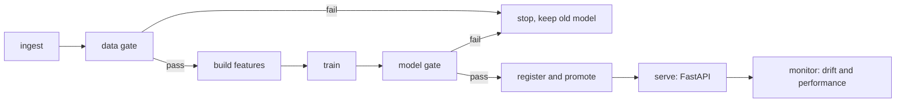

# House Price MLOps Pipeline

An automated pipeline that takes raw property listings all the way to a live,
monitored prediction service, and stops safely when the data or the model is
not good enough. Built for Project 4 of the MLOps elective.

The model predicts the asking price of a listing in lakhs of rupees from nine
features such as built-up area, number of rooms, age, distance to the city
centre and neighbourhood score.

## What is in here

```
config/config.yaml          single source of truth for the whole pipeline
src/config_loader.py        loads and validates the config
src/features.py             feature logic shared by training and serving
src/stages/                 ingest, validate, features, train, evaluate, register, monitor
src/pipeline.py             Prefect flows that wire the stages together
src/serving/app.py          FastAPI service with Prometheus metrics
run_pipeline.py             train and promote, or run a single batch
run_monitoring.py           drift and performance report over the three batches
scripts/demo_failures.py    the two safe-failure demonstrations
tests/                      unit tests for config, gates, features, model, drift
monitoring/                 Prometheus config and provisioned Grafana dashboard
models/production/          the promoted model and its lineage record
.github/workflows/          CI on pull requests, release on merge to main
```

## How the pipeline is put together

The pipeline is a set of separate stages. Each one has defined inputs and
outputs and can be run on its own. Prefect records a run for every flow with a
node per stage.



Two gates protect production:

- The **data gate** (`src/stages/validate_data.py`) checks the schema, the
  share of missing values and the value ranges set in `config.yaml`. A batch
  that breaks any rule is rejected.
- The **model gate** (`src/stages/evaluate.py`) checks a freshly trained model
  against an absolute quality bar and against the model already in production.
  A model that is worse is not promoted.

When either gate fails the run ends cleanly and the model currently in
production keeps serving. Nothing except the pipeline ever changes the
production model.

## Quick start

Use Python 3.10 or 3.11.

```bash
python -m venv .venv
.venv\Scripts\activate          # Windows PowerShell
pip install -r requirements.txt
```

Run the tests:

```bash
pytest -q
```

Train and promote the first model (writes `models/production/` and logs a run
to MLflow under `mlflow.db`):

```bash
python run_pipeline.py
```

Run drift and performance monitoring over the three incoming batches (writes
`data/results/monitoring_report.md` and `.json`):

```bash
python run_monitoring.py
```

Show the two safe-failure scenarios:

```bash
python -m scripts.demo_failures
```

## Serving the model

```bash
uvicorn src.serving.app:app --host 0.0.0.0 --port 8000
```

```bash
curl http://localhost:8000/health
curl http://localhost:8000/lineage
curl -X POST http://localhost:8000/predict -H "Content-Type: application/json" -d "{\"Area_sqft\":1200,\"Bedrooms\":3,\"Bathrooms\":2,\"Age_Years\":10,\"Distance_to_Center_km\":5.0,\"Neighborhood_Score\":8.0,\"Has_Parking\":1,\"Property_Condition\":\"Good\",\"City_Zone\":\"North\"}"
```

The service exposes `/metrics` for Prometheus: request count, error count,
latency and the distribution of predicted prices.

## The full stack with Docker

Docker is not installed on the primary development machine, so the container
and Grafana steps are carried out by the second team member. The setup is in
`docker-compose.yml` and is documented in `HANDOVER_DOCKER.md` and
`GRAFANA_SETUP.md`.

```bash
docker compose up --build -d
```

| Service | URL | Purpose |
|---------|-----|---------|
| app | http://localhost:8000 | FastAPI prediction service |
| prometheus | http://localhost:9090 | scrapes the service metrics |
| grafana | http://localhost:3000 | dashboard, admin / admin |
| mlflow | http://localhost:5000 | tracking and registry UI |

Grafana comes up with the Prometheus data source and the House Price API
dashboard already loaded.

## Tracking, registry and lineage

Every training run is logged to MLflow with its parameters, metrics, a content
hash of the training data and the config version. The model is registered and
promoted to Production only through the pipeline. From the deployed model you
can read `models/production/lineage.json` (also served at `/lineage`) to get
the MLflow run id, the git commit, the config version and the holdout metrics,
which ties the running service back to the exact run that produced it.

## CI and release

- `ci.yml` runs on every pull request: the test suite, a lightweight end to
  end pipeline run and a Docker build.
- `release.yml` runs on merge to main: it builds the image tagged with the
  commit SHA and publishes a GitHub Release with the image tarball attached.
- Rolling back to a previous build is described in `ROLLBACK.md`.

## Configuration

`config/config.yaml` holds every path, threshold and hyperparameter. Nothing
is hard-coded in the source. The config is validated when it is loaded, so a
missing section or an out-of-range threshold fails immediately rather than
halfway through a run.
